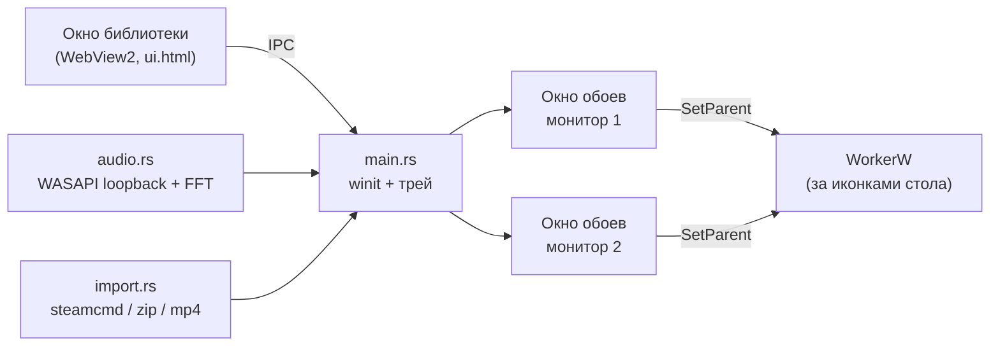

<div align="center">

# 🌊 Luma Wallpaper

**Живые обои для Windows 10 на Rust — с поддержкой обоев Wallpaper Engine**


</div>

---

## ✨ Возможности

| | |
|---|---|
| 🎬 **Видео-обои** | `.mp4` / `.webm` с аппаратным декодированием через WebView2 |
| 🌐 **Web-обои** | HTML/JS-страницы с пользовательскими свойствами из `project.json` |
| 🔊 **Реакция на звук** | Системный звук (WASAPI loopback) → 128-полосный спектр, как в Wallpaper Engine |
| 🖥 **Несколько мониторов** | Одни обои на все мониторы или разные на каждый |
| ⏸ **Умная пауза** | Полноэкранные игры и приложения, работа от батареи, ручная пауза из трея |
| 📥 **Загрузка обоев** | Steam Workshop (через ваш `steamcmd`) и прямые ссылки на `.zip` / `.mp4` / `.webm` |
| 🚀 **Автозапуск и трей** | Запуск вместе с Windows, окно прячется в трей |

## 🧩 Совместимость с Wallpaper Engine

| Тип обоев | Поддержка |
|---|:---:|
| `video` | ✅ |
| `web` | ✅ (`wallpaperPropertyListener`, `wallpaperRegisterAudioListener`) |
| `scene` | 🚧 в планах (формат `.pkg`, шейдеры, частицы) |
| `application` | ❌ |

Подойдёт любая папка с `project.json`, в том числе из  
`Steam\steamapps\workshop\content\431960\<id>`.

## 🚀 Быстрый старт

Нужны [Rust](https://rustup.rs) и [WebView2 Runtime](https://developer.microsoft.com/microsoft-edge/webview2/) (на Windows 10/11 обычно уже установлен).

```powershell
git clone https://github.com/BlackCapone/luma-wallpaper
cd luma-wallpaper
cargo run --release
```

Автозапуск прописывает `luma-wallpaper.exe --tray`: приложение стартует сразу в трей.

## 📥 Как добавить обои

1. **Папка.** В настройках выберите папку с обоями (например, папку мастерской Steam). Подпапки с `project.json` появятся в библиотеке.
2. **Прямая ссылка.** Вставьте ссылку на `.zip` (обои в формате Wallpaper Engine), `.mp4` или `.webm` в поле «Загрузить» на экране библиотеки.
3. **Steam Workshop.** Вставьте ссылку на страницу обоев или ID.  
   Для этого нужен установленный [steamcmd](https://developer.valvesoftware.com/wiki/SteamCMD) и аккаунт Steam с купленным Wallpaper Engine:
   - один раз войдите в консоли: `steamcmd +login <логин>` (Steam Guard подтверждается там же);
   - укажите путь к `steamcmd.exe` и логин в настройках Luma.

> Luma не обходит проверку владения игрой и не использует сторонние «скачиватели» мастерской.

## 🏗 Как это устроено



Окно с обоями получает сообщение `0x052C` у `Progman`, после чего становится дочерним окном `WorkerW`: оно лежит поверх обоев рабочего стола и под иконками.

```
src/
├── main.rs      цикл событий, окна, трей, IPC
├── desktop.rs   WorkerW, пауза, автозапуск
├── we.rs        project.json Wallpaper Engine, сканирование библиотеки
├── audio.rs     захват звука и спектр
├── import.rs    загрузка и распаковка обоев
├── settings.rs  настройки в %APPDATA%\Luma
└── ui.html      интерфейс
```

## 🗺 Планы

- [x] Видео и web-обои
- [x] Несколько мониторов, трей, автозапуск, пауза
- [x] Реакция на звук
- [x] Импорт по ссылке
- [ ] Плейлисты и смена обоев по расписанию
- [ ] Громкость, масштаб, лимит fps
- [ ] Scene-движок на `wgpu`
- [ ] Окно обоев на Windows 11 24H2 (проверка)

## ⚖️ Дисклеймер

Luma Wallpaper — независимый проект и не связан с Wallpaper Engine, Valve или Steam. Обои принадлежат их авторам: используйте только те, на которые у вас есть права.
